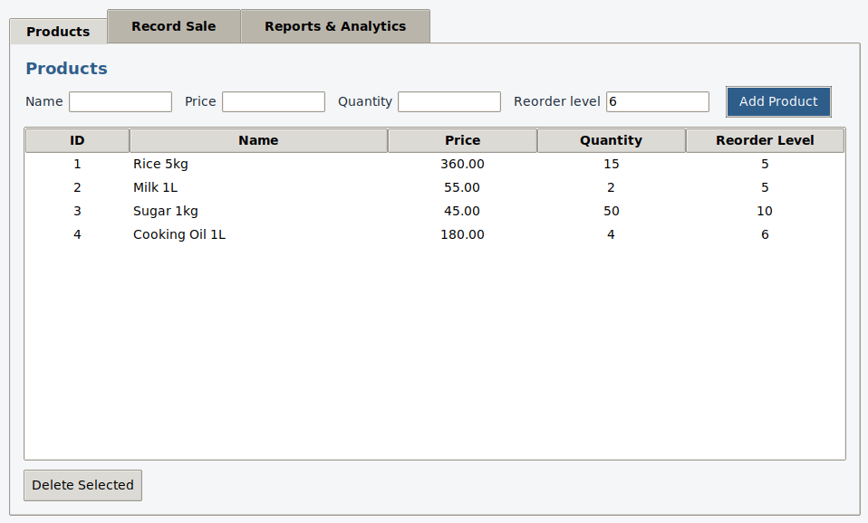
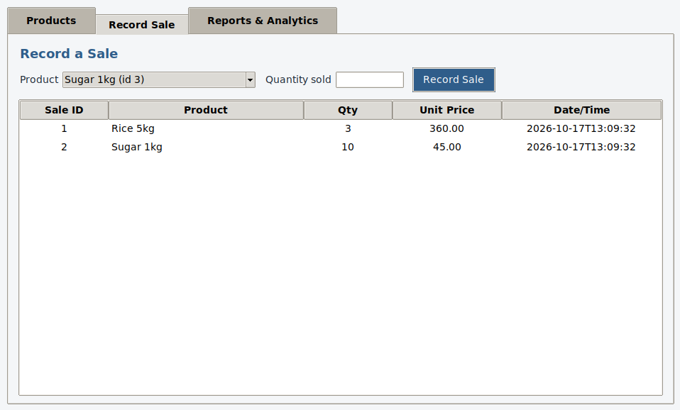
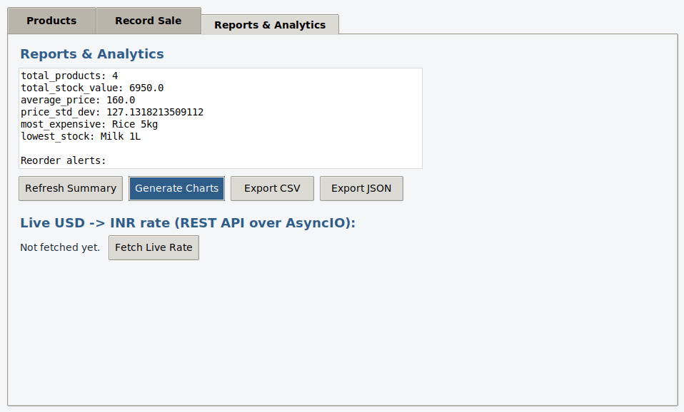

# 📦 Inventory Management & Sales Analytics System

A Python desktop application that manages products, suppliers, stock and sales,
and turns sales history into analytics — built as a micro project for
**Advanced Python Programming**.

Covers all five course modules — OOP, Functional Programming, Concurrency &
Performance, Data Handling, and Application Development — across **7 build
levels**, each runnable and testable on its own.

---

## ✨ Features

- Full CRUD for products via a Tkinter GUI, backed by SQLite
- Record sales — stock is automatically reduced, with validation against overselling
- Automatic low-stock / reorder alerts
- Sales & inventory analytics with Pandas and NumPy
- Matplotlib charts: stock value by product, current stock vs. reorder level
- CSV and JSON import/export
- Regex-based input validation
- Multithreading, multiprocessing and AsyncIO demos with logging
- Live USD → INR exchange rate fetched from a public REST API

---

## 🧱 Tech Stack

`Python 3` · `Tkinter` · `SQLite` · `Pandas` · `NumPy` · `Matplotlib` · `AsyncIO` · `aiohttp` · `Regex`

---

## 🗂 Project Structure

```
inventory_system/
├── main.py                      # entry point - launches the GUI
├── models/
│   └── product.py               # Level 1 - OOP (Product, PerishableProduct)
├── db/
│   └── database.py              # Level 2 - SQLite schema, CRUD, sales
├── processing/
│   └── analytics.py             # Level 3 - functional programming
├── concurrency/
│   └── tasks.py                 # Level 4 - threading / multiprocessing / asyncio
├── data_handling/
│   └── data_tools.py            # Level 5 - NumPy / Pandas / regex / CSV / JSON
├── analytics/
│   └── charts.py                # Level 6 - Matplotlib charts + reorder alerts
├── api/
│   └── supplier_api.py          # Level 7 - REST API (AsyncIO)
├── gui/
│   └── app.py                   # Level 7 - Tkinter GUI, ties everything together
├── test_level1.py ... test_level6.py   # standalone demo/test scripts per level
└── README.md
```

---

## 🚀 Getting Started

### 1. Clone the repo
```bash
git clone https://github.com/YOUR_USERNAME/YOUR_REPO_NAME.git
cd YOUR_REPO_NAME/inventory_system
```

### 2. Create a virtual environment
```bash
python3 -m venv venv
source venv/bin/activate        # On Windows: venv\Scripts\activate
```

### 3. Install dependencies
```bash
pip install pandas numpy matplotlib aiohttp
```

> Tkinter usually ships with Python. On Ubuntu/Debian/WSL, if `import tkinter` fails:
> ```bash
> sudo apt install python3-tk
> ```

### 4. Run the application
```bash
python3 main.py
```

**Note:** the virtual environment must be activated (`source venv/bin/activate`)
in every new terminal session before running the app again.

---

## 🧩 Running Each Level Individually

| Level | Covers | Run it with |
|---|---|---|
| 1 | OOP — Product / PerishableProduct classes | `python3 test_level1.py` |
| 2 | SQLite database + CRUD | `python3 test_level2.py` |
| 3 | Functional programming (lambda, map/filter/reduce, generators, iterators, decorators, closures) | `python3 test_level3.py` |
| 4 | Concurrency (threading, multiprocessing, AsyncIO) + logging | `python3 test_level4.py` |
| 5 | NumPy/Pandas analytics, regex validation, CSV/JSON | `python3 test_level5.py` |
| 6 | Matplotlib charts + reorder alerts | `python3 test_level6.py` |
| 7 | Tkinter GUI + REST API + full integration | `python3 main.py` |

---

## 🖥 Screenshots

**Products** — add, view and delete products, with live stock and reorder levels.


**Record Sale** — pick a product, sell units, and stock updates automatically.


**Reports & Analytics** — summary stats, reorder alerts, chart generation, CSV/JSON export, and a live REST API rate fetch.


---

## 📝 Notes

- `db/inventory.db` is created automatically on first run. Delete it anytime
  for a clean, empty database.
- The live exchange-rate fetch (Reports tab) needs an internet connection.
- `inventory.log` captures logging output from the concurrency demo.

---

## 📄 License

This project was built for academic purposes as part of an Advanced Python
Programming micro project.
